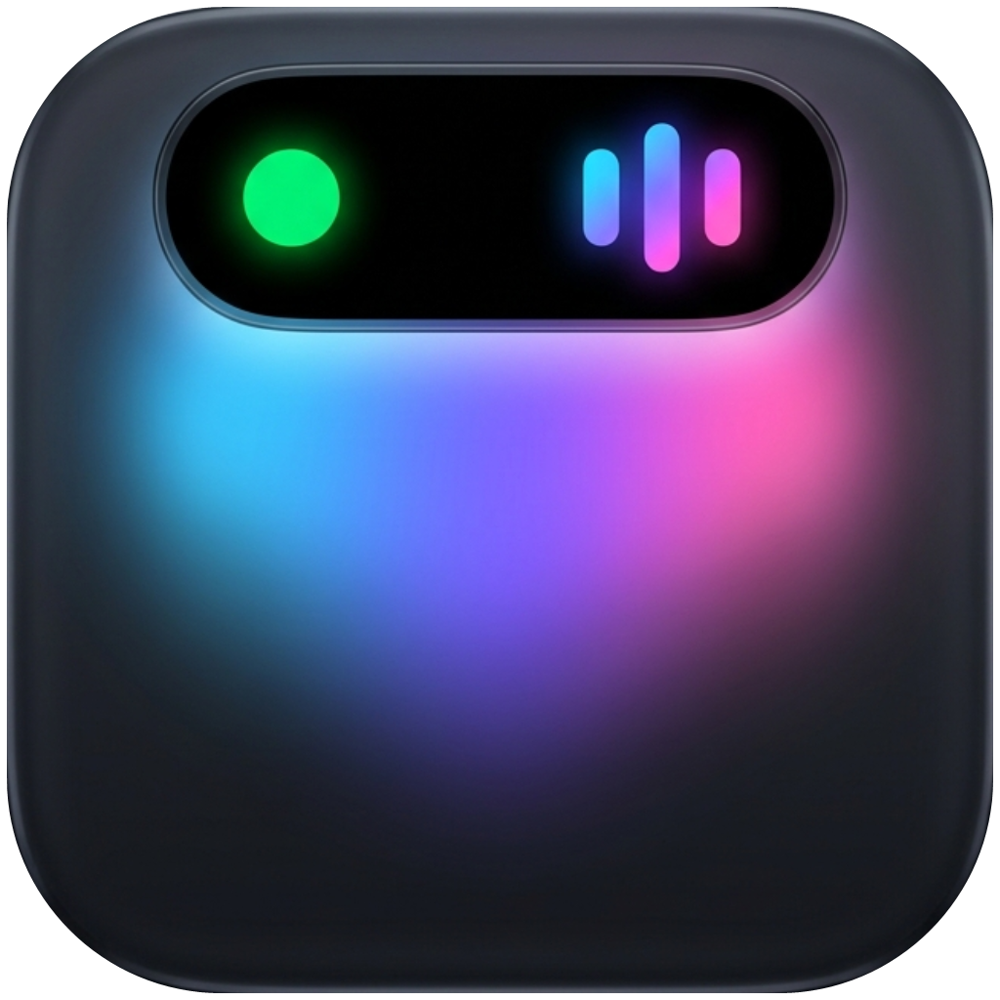
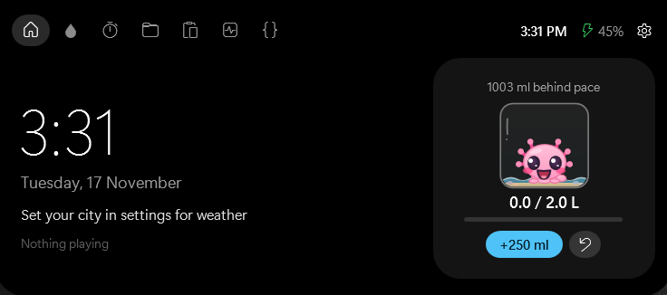
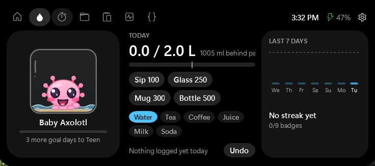
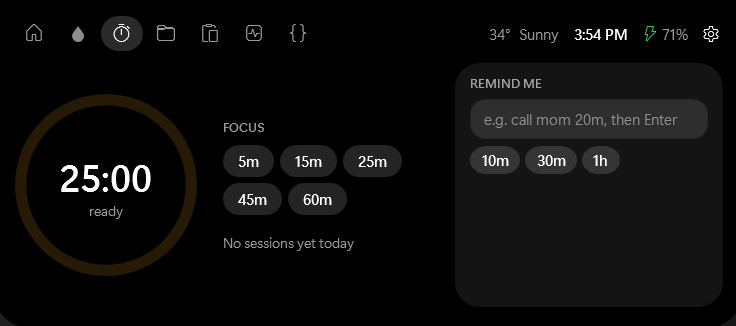
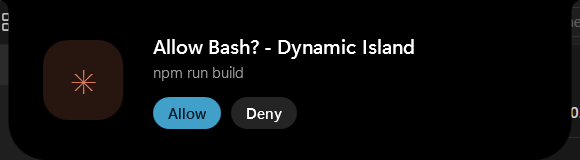
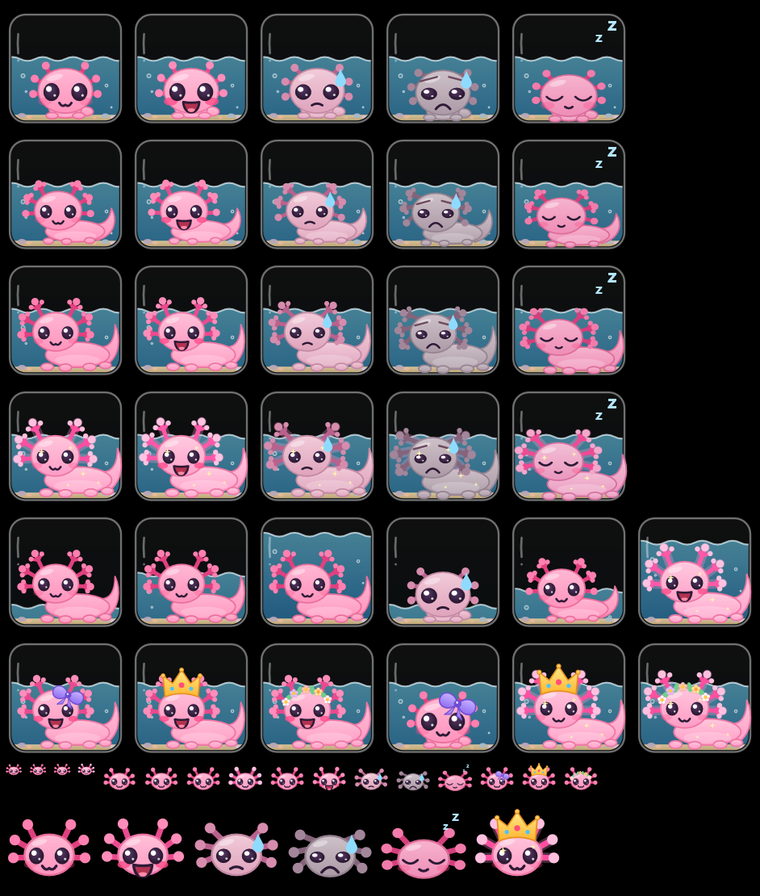
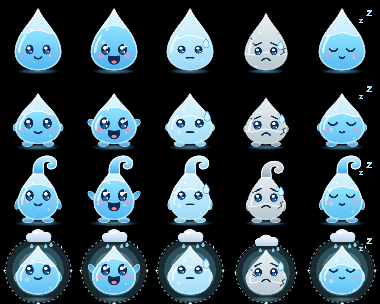
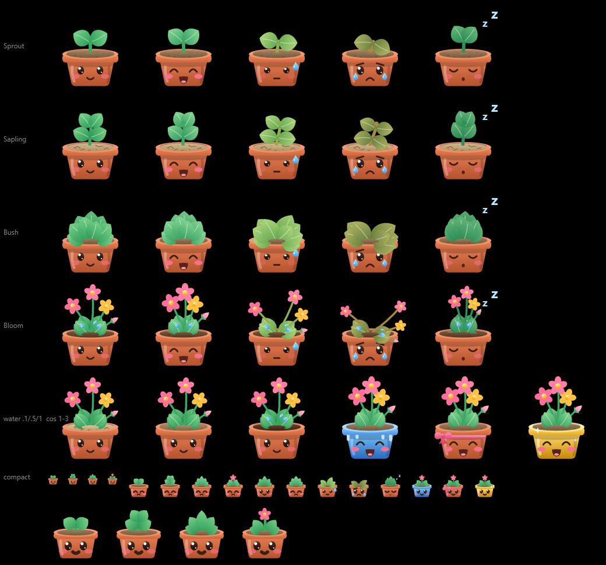
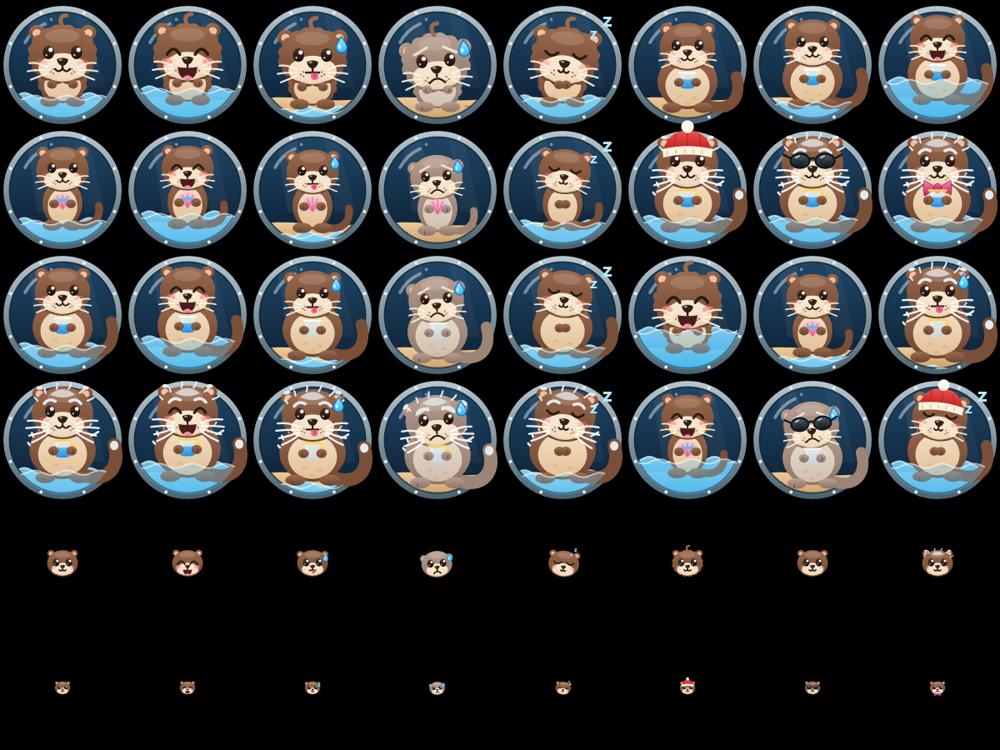

<p align="center">
  
</p>

<h1 align="center">Dynamic Island for Windows &amp; Android</h1>

<p align="center">
  A notch-style live-activity island for your PC and phone: music, notifications, timers, Claude Code sessions,
  system stats, a file shelf, clipboard history — and a hydration pet that grows as you drink water.
  Laptop and phone stay in sync.
</p>

<p align="center">
  
  
</p>
<p align="center">
  
  
</p>

---

## Contents

- [Features](#features)
- [The hydration pet](#the-hydration-pet)
- [Install](#install) — [Windows](#windows) · [Android](#android)
- [Optional set-up](#optional-set-up) — [Weather](#weather) · [Claude Code](#claude-code) · [Terminal](#powershell-command-finished) · [Phone sync](#phone--laptop-sync-twindesk)
- [Build from source](#build-from-source)
- [Island API](#island-api)
- [Privacy](#privacy)
- [Project layout](#project-layout)
- [Notes &amp; credits](#notes--credits)

---

## Features

### Windows (C# / WPF, .NET 10)

| | |
|---|---|
| **Docked bar** | When idle the island shrinks to a thin bar at the top edge (water progress as a hairline). Hover to peek, click to open. The window hugs the island, so it never blocks clicks or screenshots. |
| **Now playing** | Album art, title, equalizer bars driven by the real audio level, colour taken from the cover, click-to-seek, prev/play/next. Works with Spotify, browsers, Media Player — anything using Windows media controls. |
| **Live peeks** | Volume, brightness, charging / low / full battery, energy saver, Bluetooth connect, microphone / camera in use, copied text, track changes. |
| **Notifications** | Windows notifications peek into the island with the sending app's real icon. |
| **Claude Code** | Live "Claude is working" pill per session (several sessions are told apart), "needs you" / "finished" peeks, and **Allow / Deny** for permission prompts right in the island. |
| **7 tabs** | Home · Water & pet · Focus timer + reminders · File shelf (drag files in/out) · Clipboard history · System (CPU / RAM / network graphs) · Dev (Claude sessions, long terminal commands, builds). |
| **Polish** | Notch shape with curved ears, spring animations (or "reduce motion"), hides during fullscreen games/videos, custom dark settings window, Ctrl+Alt+W / Ctrl+Alt+I / Ctrl+Alt+V hotkeys. |

### Android (Kotlin, no AndroidX)

| | |
|---|---|
| **Island around the camera** | Docks to just the punch-hole camera when idle (with a water-progress ring); expands into swipeable pages. |
| **Live activities** | Music with controls, calls with a timer, downloads / progress rings, navigation next-turn, charging animation, focus timer. |
| **Notifications** | Peeks with the app's icon, one-tap **Copy OTP**, and inline **reply**. |
| **Status** | Bluetooth (with battery), camera / mic dots, volume, Silent / Vibrate / Ring. |
| **Gestures** | Tap = peek / expand, long-press = open the app, swipe down = notification shade, swipe sideways = pages. |
| **App** | Tabbed settings (Home · Water & pet · Island · Sync · Setup). |

---

## The hydration pet

Pick one of four characters. Each grows through **4 stages** as you hit your daily goal (3 / 10 / 25 goal days),
unlocks **3 looks**, shows today's water (tank level, body fill, soil moisture, pool), follows your cursor or touch,
dances to music, sleeps at night and reacts every time you drink.

| Axolotl | Droplet |
|---|---|
|  |  |
| **Plant** | **Otter** |
|  |  |

What makes it more than a timer:

- **Pace-based reminders** — only when you're actually behind for the time of day, never within 20 minutes of a drink, and they back off if ignored. Quiet at night.
- **Drink types** — water, tea, coffee, juice, milk, soda, each counted by its hydration value (coffee counts 80 %), with a caffeine note.
- **Personal goal** — manual, or from your weight and exercise (+10 % on hot days, using the weather).
- **Streaks with freezes** — a day counts at 80 % of the goal; a 7-day streak earns a freeze that saves a missed day.
- **History** — 7-day chart, achievements, quick-add cups, undo.

---

## Install

Ready-made builds are on the [**Releases**](../../releases) page.

### Windows

**Needs:** Windows 10 (2004) or Windows 11, and the [.NET 10 Desktop Runtime](https://dotnet.microsoft.com/download/dotnet/10.0) (x64).

1. Download `DynamicIsland-Windows-x64.zip` from Releases and extract it anywhere (e.g. `C:\Apps\DynamicIsland`).
2. Run `DynamicIsland.exe`. Windows SmartScreen may warn because the app isn't code-signed: **More info → Run anyway**.
3. The island appears at the top-centre of your screen and its logo appears in the system tray (left-click opens the island, right-click shows the menu).
4. Right-click the island (or the tray icon → Settings) and turn on **Start with Windows** if you want it at sign-in.

**Controls:** hover the bar to peek · click to open · scroll on it for volume (on the tab bar to switch tabs) ·
drag files onto it for the shelf · **Ctrl+Alt+W** log a drink · **Ctrl+Alt+I** open/close · **Ctrl+Alt+V** clipboard.

### Android

**Needs:** Android 8.0+ (tested on Android 13).

1. Download `DynamicIsland-Android.apk` from Releases and install it (allow installing from your browser / file manager when asked).
2. Open the app → **Setup** tab and grant, one by one:
   - **Draw over other apps** — shows the island.
   - **Notification access** — music, calls, notification peeks, OTP, reply.
     *Android 13+ blocks this for sideloaded apps at first:* Settings → Apps → Dynamic Island → ⋮ → **Allow restricted settings**, then try again.
   - **Accessibility** (recommended) — puts the island *above* the status bar, makes it tappable, and removes the
     "displaying over other apps" and "Island is on" notifications. It reads nothing.
   - **Notifications** — water reminders and timer alerts.
   - **Bluetooth** (optional) — device connect / battery peeks.
3. Phones with aggressive battery savers (Xiaomi, Infinix/Tecno/itel, Oppo, Vivo…): allow **Auto-start** and set
   battery to **No restrictions / Unrestricted** for the app, or the island may be killed in the background.
4. If the pill doesn't sit perfectly around your camera: **Island** tab → *Auto-fit to camera*, or adjust the position/size sliders.

> After updating the app, some phones switch its accessibility service off — re-enable it if the island drops under the status bar.

---

## Optional set-up

### Weather

Settings → General → **Weather**: choose **City** or **PIN code** (6-digit Indian PIN). Uses the free
[Open-Meteo](https://open-meteo.com) API; PIN codes are resolved with India Post's directory and OpenStreetMap. No account or key.

### Claude Code

Get Claude Code sessions in the island — live status, "needs you" / "finished" peeks, and **Allow / Deny** for permission prompts.

1. Island Settings → **Developer** → **Install Claude Code hooks**.
   This copies the hook script to `%APPDATA%\DynamicIsland\hooks\` and registers it in `~/.claude/settings.json`
   (your file is backed up as `settings.json.island-backup` first).
2. Start a new Claude Code session (hooks are read when a session starts).
3. Try **Run demo** on the same page to see it without Claude.

How it behaves:

- Each session is labelled by its project folder; a second session in the same folder becomes "Project #2".
- Permission prompts show the tool and command. Answer in the island **or** in Claude Code — answering in the chat clears the island's question.
- If the island isn't running, everything falls back to Claude Code's normal prompts.
- Manual set-up and details: [`windows/hooks/README.md`](windows/hooks/README.md).

### PowerShell: command finished

Settings → Developer → **Install PowerShell hook** — a peek when a command that ran 10+ seconds finishes or fails
(adds one line to your PowerShell profile; remove it the same way).

### Phone ⇄ laptop sync (TwinDesk)

Water log, goal, cups, pet choice/looks, streaks and badges sync between the Windows and Android apps using
[TwinDesk](https://github.com/InukaAsith/TwinDesk)'s **shared folder** (no cloud). Each device writes only its own
file (`pc.json` / `phone.json`) and merges the other's, so nothing is ever overwritten; streaks and growth are
recomputed from the merged drinks so both sides always agree.

1. Install TwinDesk on both devices and pair them.
2. **On the PC**, in TwinDesk turn on **Share a folder with *your phone*** (default folder: `%USERPROFILE%\MacShare`).
   The island writes to `MacShare\DynamicIsland\` automatically (Settings → **Phone sync** shows status).
3. **On the phone**, Dynamic Island → **Sync** tab → **Pick folder** → choose **MacShare on *your PC*** → **DynamicIsland** → *Use this folder*.
4. Done. Whenever the phone is connected to TwinDesk (Wi-Fi, USB or Wi-Fi Direct) both sides merge; in between each
   works on its own.

---

## Build from source

### Windows

Requires the [.NET 10 SDK](https://dotnet.microsoft.com/download/dotnet/10.0) on Windows.

```powershell
cd windows
dotnet publish DynamicIsland -c Release -r win-x64 --self-contained false -o publish
.\publish\DynamicIsland.exe
```

### Android

Requires JDK 17+ and the Android SDK (platform 35, build-tools). No Android Studio needed.

```powershell
cd android
# tell Gradle where the SDK is (once)
"sdk.dir=C:\\path\\to\\Android\\Sdk" | Out-File -Encoding ascii local.properties
.\gradlew.bat assembleRelease
# app\build\outputs\apk\release\app-release.apk  (signed with the debug key, for sideloading)
adb install -r app\build\outputs\apk\release\app-release.apk
```

### Logo

The app icon was designed in Google Stitch (`design/logo/logo-render.jpg`). Regenerate every icon size for both apps with:

```powershell
powershell -ExecutionPolicy Bypass -File design\logo\make-icons.ps1
```

---

## Island API

The Windows island listens on `http://127.0.0.1:47821` (local only; every request needs the header `X-Island: 1`,
which browsers can't send cross-site). Scripts, builds and tools can push live activities, peeks and questions:

```powershell
$h = @{ 'X-Island' = '1' }
Invoke-RestMethod http://127.0.0.1:47821/activity -Method Post -Headers $h -ContentType application/json `
  -Body '{"id":"build1","title":"Building app","icon":"build","state":"running","progress":0.4}'
Invoke-RestMethod http://127.0.0.1:47821/notify -Method Post -Headers $h -ContentType application/json `
  -Body '{"title":"Deployed","body":"v2.3 is live","icon":"deploy"}'
```

Endpoints: `/activity`, `/notify`, `/ask` (waits for a button click), `/show` (open a tab). Full reference:
[`windows/hooks/README.md`](windows/hooks/README.md).

---

## Privacy

- Everything stays on your devices: settings, water history, shelf and reminders live in `%APPDATA%\DynamicIsland` (Windows) and app storage (Android).
- Clipboard history is kept **in memory only**; copies from password managers are skipped and password-looking text is hidden.
- The only network calls are the optional weather lookup (city name or PIN code) and your own phone ⇄ laptop sync through TwinDesk.
- The Android accessibility service reads nothing; it only provides a window type and keeps the island alive.

---

## Project layout

```
windows/
  DynamicIsland/      WPF app: IslandWindow (island + tabs), SettingsWindow, Pets/, Services/
  hooks/              Claude Code + PowerShell hook scripts and API docs
android/
  app/src/main/java/com/rsv/dynamicisland/
                      IslandService + IslandView (overlay), NotifListener, IslandA11y, Water, Sync, pet/
design/logo/          Stitch logo + script that builds every icon size
docs/images/          README images
```

Per-platform notes: [`windows/README.md`](windows/README.md) · [`android/README.md`](android/README.md)

---

## Notes &amp; credits

- "Dynamic Island" is the name of Apple's iPhone feature; this project is an independent take on the idea for Windows and Android and isn't affiliated with Apple.
- Not affiliated with Anthropic. The Claude logo shown for Claude Code sessions is read at runtime from the Claude Code extension installed on your machine; it isn't bundled here.
- App logo designed with [Google Stitch](https://stitch.withgoogle.com). Weather by [Open-Meteo](https://open-meteo.com). PIN-code lookup via India Post and [OpenStreetMap Nominatim](https://nominatim.openstreetmap.org).
- Phone sync rides on [TwinDesk](https://github.com/InukaAsith/TwinDesk)'s shared-folder feature.
- Windows notification peeks read Windows' local notification database (there's no public API for unpackaged apps), so a future Windows update could change it; the island would simply stop showing toasts.
